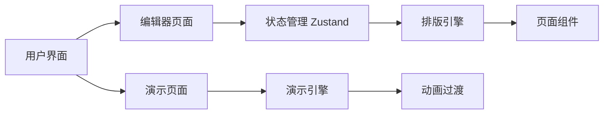
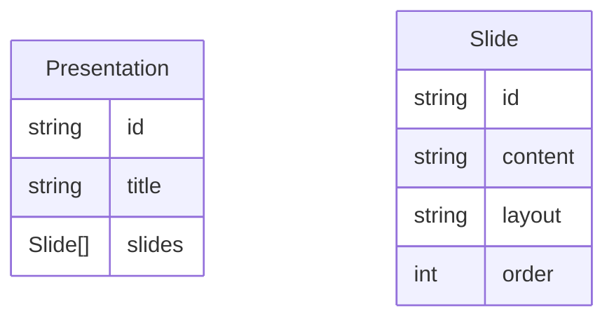

## 1. Architecture Design
纯前端应用，无需后端服务。所有逻辑在客户端完成，使用 React 状态管理，支持本地存储和导出功能。



## 2. Technology Description
- **Frontend**: React@18 + TypeScript + Vite + Tailwind CSS
- **状态管理**: Zustand
- **Markdown解析**: react-markdown
- **图标库**: lucide-react
- **初始化工具**: vite-init
- **后端**: 无（纯前端应用）
- **数据库**: 无（本地存储）

## 3. Route Definitions
| Route | Purpose |
|-------|---------|
| / | 编辑器主页面 |
| /present | 演示页面 |

## 4. API Definitions
无后端API

## 5. Server Architecture Diagram
不适用（无后端）

## 6. Data Model

### 6.1 Data Model Definition


### 6.2 Data Definition Language
不适用（无数据库）

### 6.3 TypeScript 数据类型
```typescript
interface Slide {
  id: string;
  content: string;
  layout: 'title' | 'content' | 'two-column' | 'image';
  order: number;
}

interface Presentation {
  id: string;
  title: string;
  slides: Slide[];
  createdAt: Date;
  updatedAt: Date;
}
```
