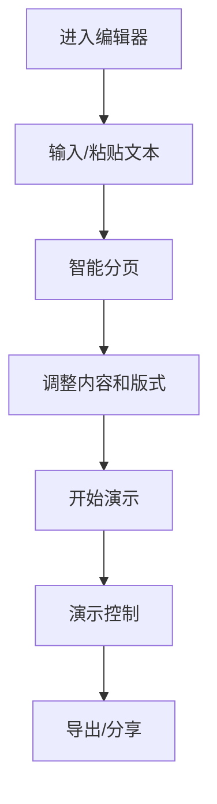

## 1. Product Overview
轻量在线汇报工具，用户可快速录入/粘贴文字素材，系统按PPT逻辑自动分页排版，生成可演示的HTML页面，替代传统PPT实现轻量化线上汇报。

- 解决问题：PPT制作繁琐、分享不便、格式兼容性问题
- 目标用户：需要频繁做工作汇报的职场人士、学生
- 市场价值：让汇报变得更简单、更高效、更易分享

## 2. Core Features

### 2.1 User Roles
| Role | Registration Method | Core Permissions |
|------|---------------------|------------------|
| Normal User | 无需注册 | 完整使用所有功能 |

### 2.2 Feature Module
1. **编辑器页面**：文本录入/粘贴、分页预览、版式选择
2. **演示页面**：全屏演示、页面导航、键盘控制

### 2.3 Page Details
| Page Name | Module Name | Feature description |
|-----------|-------------|---------------------|
| 编辑器页面 | 文本输入区 | 支持多行文本输入、粘贴、Markdown格式支持 |
| 编辑器页面 | 智能分页 | 自动按段落/标题拆分内容为页面 |
| 编辑器页面 | 版式选择 | 提供多种PPT版式模板（标题页、内容页、图片页等） |
| 编辑器页面 | 实时预览 | 右侧实时显示排版效果 |
| 演示页面 | 全屏演示 | 点击进入演示模式，全屏显示 |
| 演示页面 | 导航控制 | 键盘方向键/空格翻页、页面指示器 |
| 演示页面 | 导出功能 | 导出为HTML文件或分享链接 |

## 3. Core Process
用户使用流程：
1. 进入应用，在编辑器中粘贴或输入汇报素材
2. 系统自动将内容分割成页面
3. 用户可以调整页面内容、选择版式
4. 点击"开始演示"进入演示模式
5. 使用键盘或导航按钮进行演示
6. 可选择导出HTML或分享链接

## 4. User Interface Design

### 4.1 Design Style
- **主色调**：深蓝色 (#2D3748) + 天蓝色 (#3182CE)，营造专业感
- **辅助色**：浅灰 (#F7FAFC)、中灰 (#E2E8F0)
- **按钮风格**：圆角矩形，轻微阴影，悬停有缩放效果
- **字体**：使用 Inter 作为正文，Playfair Display 作为标题
- **布局风格**：左右分栏，左侧编辑区，右侧预览区
- **图标风格**：简约线性图标

### 4.2 Page Design Overview
| Page Name | Module Name | UI Elements |
|-----------|-------------|-------------|
| 编辑器页面 | 顶部导航 | Logo、功能按钮（开始演示、导出） |
| 编辑器页面 | 左侧编辑区 | 大文本框、智能分页提示 |
| 编辑器页面 | 右侧预览区 | 页面卡片列表、滚动查看 |
| 编辑器页面 | 版式选择 | 底部版式模板选择器 |
| 演示页面 | 全屏容器 | 黑色背景、居中内容、动画过渡 |
| 演示页面 | 导航控制 | 底部页码指示器、前进/后退按钮 |

### 4.3 Responsiveness
- **桌面优先**：针对大屏幕优化左右分栏布局
- **移动端适配**：在小屏幕上切换为上下布局，预览区可折叠
- **触摸优化**：演示模式支持触摸滑动翻页

### 4.4 3D Scene Guidance
不适用
